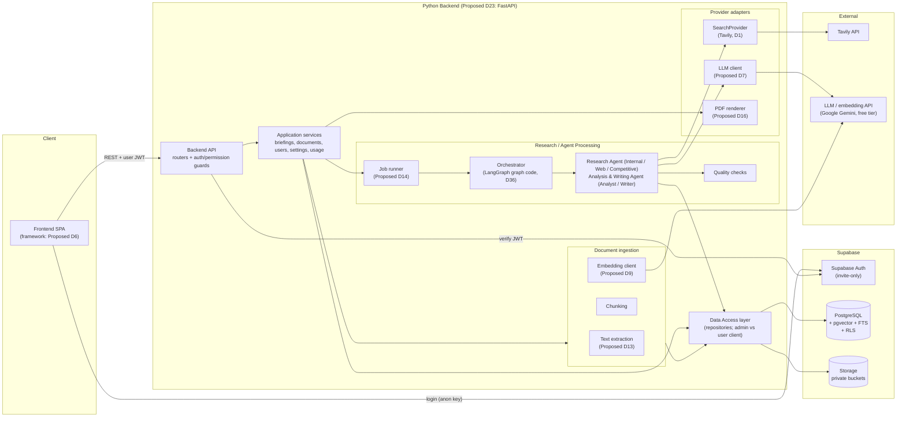
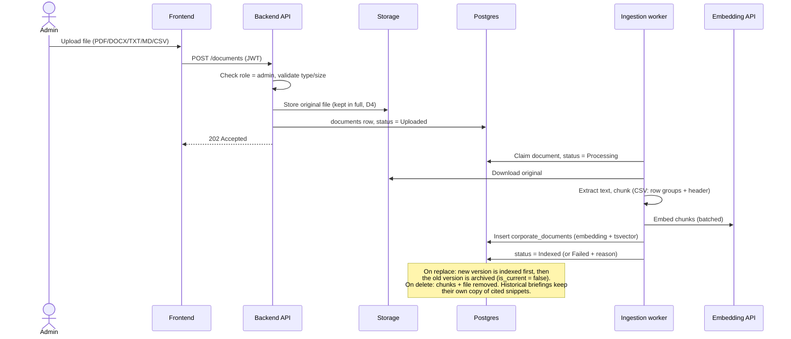
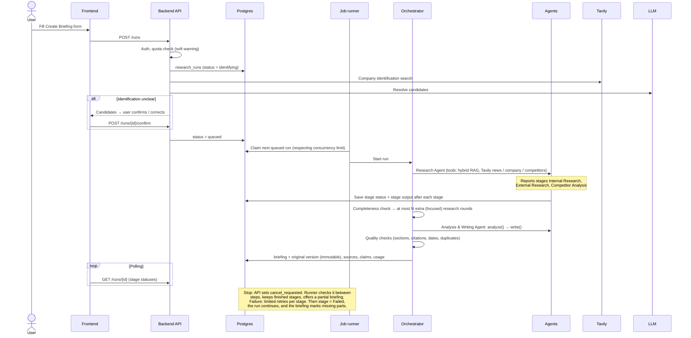
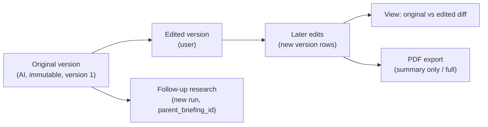

# Deal-Prep Copilot – Architecture

*Written during development. Sections 1–6 are the full design from the planning phase (2026-11-05); the portfolio MVP built a reduced scope of it (D38, D39): one Streamlit UI instead of React, Streamlit Community Cloud instead of Vercel + Hugging Face Spaces, no PDF export. What was actually built is described in the "as built" sections (§6.0 onwards). "The brief" means the original product brief the project started from (not included in this repo). Labels like "Proposed D6" refer to approved decisions in `DECISIONS.md`.*

**Planned stack (2026-11-05):** React + Vite + TS (D6) · FastAPI (D23) · Google Gemini free tier for LLM + embeddings, `vector(1536)` (D7, D9) · LangGraph (D8) · Postgres FTS `simple` + pgvector + RRF (D10, D11) · DB-backed job queue, concurrency 1 (D14, D18) · Playwright PDF (D16) · Supabase CLI `db push` for migrations, MCP for inspection (D22) · Vercel + Hugging Face Spaces (D15).

---

## 1. Principles

- Modular layers with clear boundaries: Frontend → Backend API → Research/Agent Processing → Data Access → Supabase / external services.
- **One database** for app data, vector search and keyword search: Supabase PostgreSQL + pgvector (D2).
- **Server-side permission checks** on every sensitive action. RLS on every table as a second line of defense.
- **Two Supabase keys** (D5):
  - `SUPABASE_KEY` (secret / service_role): backend only. Bypasses RLS, so every call that uses it is preceded by an explicit permission check in the API layer. Never logged, never sent to the frontend.
  - `SUPABASE_ANON_KEY` (public): used by the frontend for login, and by the backend for user-scoped queries together with the user's JWT, so RLS applies.
- **Research runs are background jobs.** They don't depend on the user's connection. Run state and stage state are persisted in the DB.
- **Sources travel with claims** end to end.
- **Swappable providers** behind small interfaces: web search (Tavily, D1), LLM, embeddings, reranker (optional, later).
- Start simple and cheap. No complex cloud infrastructure.

---

## 2. Component diagram



---

## 3. Layers and responsibilities

| Layer | Responsibility | Notes |
|---|---|---|
| **Frontend** | Screens from the brief: Dashboard, New Briefing, My Briefings, Knowledge Base, User Management (admin), Settings. Hebrew (RTL) and English display. | Only `SUPABASE_URL` + `SUPABASE_ANON_KEY`. All business actions go through the Backend API. Progress shown by polling run/stage status (or Supabase Realtime later). |
| **Backend API** | HTTP endpoints, JWT verification, role checks (`user` / `admin`), request validation, error handling, structured logging. | Thin. No business logic in routers. |
| **Application services** | Use cases: invite user, upload/replace/delete document, create run, confirm company, stop run, edit briefing, export PDF, feedback, claim reports, quotas, costs, settings. | Enforce permissions again before any service-role write. |
| **Research / Agent Processing** | Job runner, Orchestrator (graph code), 2 agents covering the 5 specialist roles (D36), data contracts, quality checks, usage recording. | No direct HTTP or DB-client code inside agents. They use tools (search, RAG) and repositories through interfaces. |
| **Document ingestion** | Validate → store original → extract text → chunk → embed → index → set status. | Runs in the background. Status: Uploaded / Processing / Indexed / Failed. |
| **Provider adapters** | `SearchProvider` (Tavily), `LLMClient`, `EmbeddingClient`, `PdfRenderer`, later `Reranker`. | Adding or replacing a provider doesn't change agents. |
| **Data Access** | Repositories per aggregate. Two Supabase clients: **admin** (service_role) and **user-scoped** (anon key + user JWT). Postgres functions (RPC) for hybrid search and job claiming. | Supabase Python client works over REST and cannot run DDL. Schema is applied from versioned SQL files (Proposed D22). |
| **Supabase** | Auth, PostgreSQL (+ pgvector, FTS), Storage, RLS. | Hosted by Supabase. |

### 3.1 Proposed repository layout (finalized in Phase 1)

```
backend/
  app/
    api/            # routers, dependencies (auth, roles)
    core/           # config (python-dotenv), logging, errors, security
    services/       # use cases
    agents/         # orchestrator, agents, prompts/ (versioned), contracts.py
    research/       # SearchProvider interface, Tavily adapter, dedup, date filters
    rag/            # extraction, chunking, embeddings, hybrid retrieval
    workers/        # job runner, ingestion worker
    data/           # repositories, supabase clients
    pdf/            # templates + renderer
  tests/            # unit + integration
  requirements.txt  # pinned (D5)
frontend/           # Proposed D6
supabase/
  migrations/       # versioned SQL files, applied with `supabase db push` (D22)
evals/              # test cases + evaluation scripts
rag_knowledge_base/ # sample internal documents (test data)
```

**As built (2026-11-08, after Phase 3):** `app/db/` holds the Supabase clients (instead of `data/`). `app/rag/` = `chunking`, `embeddings`, `ingest`, `keywords`, `retrieval`, `extractors` (2C). `app/api/` = `health`, `users`, `kb` (2C). `app/services/kb.py` and `app/workers/` (`jobs`, `ingestion`) since 2C (§6.0.2). `app/research/` = Phase 3 service (§6.0.3) + `news.py` (2B news date rules on top of the Phase 3 provider). `app/agents/` (2B) = single briefing agent + versioned prompt. Agent tools live in `app/tools.py` until Phase 4 moves them under `agents/`. CLIs sit in `backend/` (`db_setup.py`, `create_admin.py`, `ingest_data.py`, `agent.py`, `run_worker.py`). `requirements.txt` is at the repo root. `pdf/` comes in Phase 6.

---

## 4. Main data flows

### 4.1 Document ingestion



### 4.2 Research run



**Agents in the MVP (D36):** the brief's six roles run as two agents. The Orchestrator is the LangGraph graph itself: fixed flow, completeness check (may use a small LLM call to name gaps), round limit from D17 enforced in code. Splitting later = new graph nodes (e.g. Internal / Web / Competitive in parallel, or `analyze` and `write` as separate nodes) registered in one place; contracts, prompts per role (`research/`, `analysis/`, `writer/`) and the run state machine don't change. The 2B single agent (§6.0.1) stays as eval baseline and demo fallback.

Run state is designed in Phase 4 to support stop, partial results and queueing (Phase 8), so Phase 8 doesn't need a rewrite:
- Run statuses: `identifying → awaiting_confirmation → queued → running → (stopping) → completed | partial | stopped | failed`.
- Stage statuses: `pending | in_progress | completed | failed | skipped`.
- Every finished stage stores its validated output, so a partial briefing can be written from it.

### 4.3 Briefing editing and history



- The AI original is never overwritten. Edits create new `briefing_versions` rows with `kind = 'edited'`.
- Content is structured JSON (sections → blocks → claims with `info_type` and `source_ids`), so edits keep citations and labels. User notes are a separate `info_type = user_note`.
- A follow-up run reads the previous briefing and adds new research on one predefined topic.

---

## 5. Agent data contracts (outline; as built in §6.0.4)

Pydantic models, validated at every agent boundary:
- `ResearchRequest`: the request form fields, user context + classification (Internal Information / Assumption / Requires Verification).
- `Source`: `external` (url, title, publisher, published_at, retrieved_at, credibility tier) or `internal` (document id, title, version, chunk location: page / heading / CSV row range, snippet).
- `Claim`: text, `info_type` (external_fact / internal_doc / user_provided / ai_analysis / ai_recommendation / unverified), `source_ids`, confidence, conflict flag + conflicting source ids.
- `ResearchFindings` (Research Agent output): sections `internal` (`InternalFindings`), `web` (`WebFindings`), `competitive` (`CompetitorProfiles`), each with its sources and gaps. A future split into three research agents returns one section each and the graph merges them (D36).
- `Analysis` (from `analyze()`): `OpportunityRiskAnalysis` (importance High/Medium/Low + rationale, why it matters, how to address), fit, recommendations tailored to the meeting type. `write()` turns findings + analysis into the `Briefing`.
- `Briefing`: one-page summary + appendix. The 12 sections from the brief, each `complete` or `missing_info` (with reason). Metadata: language, meeting type, research date, depth, `search_languages` (D37: Hebrew / English; the briefing notes when the company's local language wasn't searched), prompt/config versions.
- `StageStatus`: 7 stages (Company Identification, Internal, External, Competitor, Strategic, Writing, Quality Checks, D25) × 5 statuses.

---

## 6. Database schema – first draft

Every table has `id uuid primary key default gen_random_uuid()` and `created_at timestamptz default now()`, unless noted. Final SQL is written in the phase that needs each table. The vector dimension `N` is fixed by **D9**. No vector table is created before D9 is approved.

| Table | Key columns | Phase |
|---|---|---|
| `profiles` | `id` (= `auth.users.id`), email, full_name, `role` (`user`/`admin`), job_title, responsibility_area, common_meeting_types `text[]`, `is_active` | 1 (profile fields in 7) |
| `documents` | title, file_name, mime_type, size_bytes, `storage_path`, checksum, `status` (uploaded/processing/indexed/failed), error_message, `version`, `replaces_document_id`, `is_current`, `archived_at`, uploaded_by, indexed_at | 2 |
| `corporate_documents` (chunks table) | `id`, `content` text, `metadata jsonb` (`file_name`, `chunk_index`, `section` = nearest header / page / CSV row range; later `document_id`, `version`), `embedding vector(1536)` (D9), `document_id` FK, `fts tsvector` (generated, `simple` config, D10) | 2 |
| `research_runs` | `user_id`, `status`, `request jsonb`, `confirmed_company jsonb`, meeting_type, depth, language, `parent_briefing_id`, follow_up_topic, `prompt_versions jsonb`, `settings_version_id`, `cancel_requested`, attempts, heartbeat_at, started_at, finished_at, error | 4 (identification fields in 5) |
| `run_stages` | `run_id`, `stage` (identification/internal/external/competitor/strategic/writing/quality), `status`, attempts, `output jsonb`, error, started_at, finished_at | 4 |
| `briefings` | `run_id`, `user_id`, company_name, meeting_type, language, `research_date`, `is_partial`, `incomplete_stages text[]`, updated_at | 4 |
| `briefing_versions` | `briefing_id`, version_no, `kind` (original/edited), `content jsonb`, created_by | 4 (original), 6 (edited) |
| `sources` | `briefing_id`, `source_type` (external/internal), url, title, publisher, published_at, retrieved_at, credibility_tier, `document_id` (nullable, `on delete set null`), document_title, document_version, `location jsonb`, `snippet` | 3/4 |
| `claims` | `briefing_id`, section, text, `info_type`, confidence, `is_conflict`, `source_ids uuid[]` | 4 |
| `organization_profile` | single row: description, domains, products, target_audiences, advantages, goals, extra, `last_reviewed_at`, updated_by | 7 (agent handles absence from Phase 4) |
| `research_templates` | `user_id`, name, meeting_type, depth, focus_areas `text[]`, preferences `jsonb` | 7 |
| `system_settings_versions` | version_no, `settings jsonb` (depth limits, source counts, search limits, enabled categories, concurrency), description, created_by, `is_active` | 4 (read), 7 (admin edit + rollback) |
| `briefing_feedback` | `briefing_id`, `user_id`, accuracy, relevance, analysis_quality, source_quality (1–5), comment | 8 |
| `claim_reports` | `briefing_id`, `claim_id`, `user_id`, explanation, corrective_source, `status` (new/under_review/resolved), resolved_by, resolved_at | 8 |
| `usage_events` | `run_id`, `user_id`, provider, service, model, agent, input_tokens, output_tokens, units (e.g. Tavily credits), `cost_usd`, `is_estimated` | 3/4 (write), 8 (reports) |
| `quotas` | `user_id` (null = default), period (month), max_runs, `is_hard_limit`, extra_runs_approved | 8 |

**Indexes:** HNSW on `corporate_documents.embedding` (cosine), GIN on `corporate_documents.fts`, btree on foreign keys and on `research_runs(status, created_at)` for job claiming.

**Postgres functions (RPC):**
- `hybrid_search(query_text, query_embedding, match_count, …)`: vector + full-text, combined by Proposed D11 (RRF). Only `is_current` documents with `status = 'indexed'`. `SECURITY INVOKER`, so RLS applies.
- `claim_next_run(max_concurrent)`: `FOR UPDATE SKIP LOCKED` job claim (Proposed D14).
- `is_admin()`: `SECURITY DEFINER` helper used by RLS policies.

### 6.0 Knowledge base as built (Phase 2A, migration `20261106140000_knowledge_base.sql`)

- `documents`: one row per file version. One current row per `file_name` (partial unique index). `checksum` (sha256) + the chunking signature and embedding model on the chunks make ingestion idempotent.
- `corporate_documents`: `id bigint identity`, `document_id` (FK, cascade), `chunk_index`, `content`, `metadata` (`file_name`, `chunk_index`, `section`, `document_id`, `version`, `chunking`, CSV `row_start`/`row_end`), `embedding vector(1536)` (HNSW cosine), `embedding_model`, `fts` generated from `section + content` (`simple`, GIN).
- `hybrid_search(query_text, query_embedding, match_count, full_text_weight, semantic_weight, rrf_k)`: `SECURITY INVOKER`; vector top 3k + keyword top 3k (terms OR-ed) → RRF; only `is_current` and `status = 'indexed'`.
- Code: `app/rag/chunking.py` → `embeddings.py` (Gemini, normalized, batched, retry) → `ingest.py` (`Ingestor`) → `retrieval.py` (`retrieve`, stop-word-free keyword query from `keywords.py`, no-op `rerank`) → `app/tools.py` (`search_internal_docs`). Seed CLI `backend/ingest_data.py`. Eval `evals/retrieval_eval.py`.

### 6.0.1 Single-agent CLI as built (Phase 2B, D33)

No DB changes. Flow: `backend/agent.py` (argparse, exit codes, footer) → `app/agents/briefing.py` `run_briefing()` → `langchain.agents.create_agent` (a LangGraph graph; `create_react_agent` is deprecated in LangGraph 1.x) with `ChatGoogleGenerativeAI` (`CHAT_MODEL`, default `gemini-3.5-flash`; the Google SDK retries 429/5xx with backoff) and two LangChain tools wrapped from `app/tools.py`:
- `search_internal_docs(query)` → hybrid retrieval (6.0), top `--k`, returns `citation` + `content`. Empty → explicit "missing" note.
- `search_live_news(company_name)` → `app/research/news.py`: `TavilyProvider` (`SearchProvider`-style, `topic=news`, usage counter) + `search_news()` date rules: 48 h first, 30-day fallback, dates parsed by us (Tavily's `days` is not strict), undated items kept as `date_unknown`, >30 days dropped, URL dedup. A Tavily error becomes a tool message (news reported missing because the search failed), not a crash.
- Bounds: `ModelCallLimitMiddleware` (6 model calls, raises) + recursion backstop 60. If a required tool was skipped: one reminder message and a second bounded pass.
- Prompt: `app/agents/prompts.py`, `PROMPT_VERSION` (now `briefing-agent/v3`): base wording + citation, date-window, missing-info and language rules; v3 (Phase 3.5) adds the grounding rules: no generic market statements, sections without specific sourced facts go to Missing information, no generic KB content as positioning, risks = sourced facts, article date ≠ event date.
- Identification (Phase 3.5, `app/agents/identify.py`): `parse_website()` validates `--website` (http(s) URL or bare domain → domain). `identify_company()` runs before the agent: one Quick `profile` query through `research_company` (≈ 1 credit, Phase 3 relevance filter); if no source survives, `search_internal_docs(company, k=3)` and a name match in the chunk text (KB-only companies such as competitors). Neither → `CompanyNotIdentified` (CLI exit 3), no LLM call. A non-fatal search error → undecided, the run continues with a footer warning. The domain goes into the user prompt ("the company whose website is …"). Without a website, `infer_official_domain()` takes the company's own domain from the identification results (2026-11-16): the domain's name label must be the typed name (legal suffixes and a trailing `.com` dropped, letters / digits only) plus at most one known suffix (`elbit` → `elbitsystems.com`; `siemens-energy.com` or a non-Latin name → no guess). In the graph run (`run_research`) the inferred domain becomes `request.website` after identification, so the company's pages are classified official (tier 1) and confidence uses them; the stored request keeps what the user typed. The briefing title uses the writer's optional `company_name` (`display_name()`: kept only if it shares a word with the typed name, or the typed name isn't Latin). The 2B news tool has no domain parameter, so the domain reaches identification and the prompt only.
- `SourceLog` records returned internal citations, news URLs and tool errors (input for persistence in Phase 4).

### 6.0.2 Knowledge base management as built (Phase 2C-API, migration `20261107120000_kb_management.sql`)

- `jobs`: generic queue (D14). `kind` (`ingest_document`; Phase 4 adds `research_run`), `payload` jsonb, `status` queued/running/succeeded/failed/cancelled, `attempts`/`max_attempts`, `run_after` (retry backoff), `locked_by` + `heartbeat_at` (stale-job recovery), `error`. RLS on with no policies: backend (service key) only.
- `claim_jobs(kind, worker, max_running)`: advisory lock per kind + `FOR UPDATE SKIP LOCKED`, claims only up to the concurrency limit (D18). `service_role` only.
- `documents` soft delete: `deleted_at`, `deleted_by`. Delete removes chunks + Storage files but keeps the rows, so briefing sources can still name the document.
- `promote_document_version(new_id)`: one transaction archives the previous version (`is_current = false`, `archived_at`), deletes its chunks and makes the new one current, so search never sees zero or two current versions. `service_role` only.
- Storage bucket `kb-documents`: private, 20 MB, PDF/DOCX/TXT/MD/CSV MIME types (D35).
- Code: `app/api/kb.py` (routes: list/get for all signed-in users through their own client so RLS applies; upload/replace/delete admin only; `/search` with the caller's token) → `app/services/kb.py` (`KnowledgeBaseService`: validation, version model) → `app/workers/jobs.py` (`JobQueue`, `Worker`; started in the API lifespan unless `WORKER_ENABLED=false`, or `python run_worker.py`) → `app/workers/ingestion.py` (download original, `Ingestor.index_document`, then promote) → `app/rag/extractors.py` (PDF pages, DOCX → markdown, TXT encodings; content-based type check).

### 6.0.3 External research service as built (Phase 3, D1, D17, D21, D37; no DB changes)

`app/research/` (agents depend only on the service and the `SearchProvider` protocol):

| Module | Role |
|---|---|
| `provider.py` | `SearchProvider` protocol (`search`, `extract`) + `TavilyClient` (httpx, `/search` + `/extract`, retries 429/5xx). Errors: `SearchError`; `FatalSearchError` (401/403 bad key, 432 plan limit) always propagates; `BudgetExceeded` is raised **before** a request when the per-run `CreditBudget` would be exceeded. `Usage` counters (requests, estimated credits, searches, extracts, cache hits). `ResponseCache` (JSON files keyed by endpoint + body) only when `TAVILY_CACHE_DIR` is set (eval/tests, D37). |
| `depth.py` | `DepthConfig` per level (D17 as amended by D37): `max_queries` (cap per run incl. extra rounds), `initial_queries` (first round; the rest is for the Orchestrator), `search_depth` = basic, `news_days`, `results_per_query`, `max_sources`, `extract_top`, `credit_cap` (8 / 20 / 40), `max_extra_rounds`, `max_per_outlet` (3), `min_hebrew_sources` (2). Becomes the seed row of `system_settings_versions` in Phase 4. |
| `languages.py` | Country (English / Hebrew name or ISO code) → `LanguagePlan`: Israel = full Hebrew + English set; other countries = English + one Hebrew query (`"<company> ישראל"`, every depth). Reports `search_languages`, the local language and whether it was searched. |
| `queries.py` | Ordered `QuerySpec`s (priority order, so the cap cuts the least important): profile, last-48h news, preferred sources (`include_domains`), Hebrew/Israel query, news over the depth range, competitors, financial, people, press. Hebrew news / financial / people queries target Israeli Hebrew outlets (`hebrew_media` in `source_tiers.json`): Tavily returns few Hebrew results otherwise (TESTING.md 2026-11-08). |
| `urls.py` | `normalize_url` (https, host case, `www.`/`amp.`, default ports, fragments, tracking params, trailing slash, `/amp`), `same_story` (title token Jaccard ≥ 0.8; short titles exact only). |
| `dates.py` | `parse_date` (RFC 2822 / ISO), `trusted_date` (future = unknown). Never invents dates. |
| `tiering.py` + `source_tiers.json` | D21 step 1: company domain → official tier 1; `.gov*`, regulators, exchanges → tier 1; listed news / financial → 2; wires → official tier 2; professional / industry / aggregators → 3; social and unknown → 4. Most specific domain wins. Preferred categories map to `include_domains` lists (priority only). |
| `sources.py` | `Source` (Pydantic, below) + `detect_language`. |
| `service.py` | `ExternalResearchService.research_company(company, country, website, depth, preferred_urls, preferred_categories, purposes, limit, budget, extract, aliases)` → `ExternalResearchResult`; `fetch_pages(urls)`. |

Pipeline: build queries → search (credit cap, partial errors listed, all-failed raises) → `Source` records (tier, language, news window: `last_48h` / `in_range` / `date_unknown`, older than the depth range dropped) → **relevance filter** (short name in title/URL or full name in snippet, aliases e.g. a Hebrew name; own-site results kept; drops are counted in `notes`) → dedup (normalized URL, then same story across outlets → `also_reported_by`, a corroboration signal for D21 step 3) → selection (preferred first, then last-48h news, tier, newest; ≤ `max_per_outlet` per outlet, all company subdomains = one outlet; Hebrew sources kept when found) → page extraction for the top `extract_top` non-tier-4 sources.

`Source` contract (external): `id` (`web_` + hash of the normalized URL), `url`, `normalized_url`, `title`, `outlet`, `published_at` (or null), `retrieved_at`, `language` (he/en/other), `source_type` (official / news / government_regulatory / financial / professional_industry / other), `tier` (1–4), `snippet`, `content` (extracted text, top results), `window` (news only), `is_preferred`, `query_purposes`, `query_languages`, `also_reported_by`, `provider_score`. Phase 4 adds the internal variant and the `sources` table (only cited sources are stored).

Agent tools (`app/tools.py`): `search_company_info`, `search_competitors` (purpose-filtered `research_company`), `fetch_page`; `search_live_news` (2B) unchanged. `app/research/news.py` keeps the 2B API (`TavilyProvider` = `TavilyClient` + `search_news`). These per-call tools stay for 2B / ad-hoc use; the Phase 4 Research Agent has its own tools with one `CreditBudget` per run (§6.0.4).

### 6.0.4 Agents and orchestration as built (Phase 4-lite, D36, D38, D40; migration `20261109113829_research_runs.sql`)

Entry point: `app/agents/orchestrator.py` `run_research(request, deps=None, on_stage=None) -> RunResult`. The CLI (`agent.py`, default mode) and the Phase 5 Streamlit app call it; `on_stage` receives every `StageStatus` change (for `st.status`). `Deps` injects the two models, the research service, the internal search, the identification check and the store (fakes in tests). The 2B single agent stays as `agent.py --single` (eval baseline).

```
            ResearchRequest
                  │
          ┌───────▼────────┐  1 Tavily credit; not identified -> CompanyNotIdentified (CLI exit 3), run saved failed
          │    identify    │  Company Identification
          └───────┬────────┘
          ┌───────▼────────┐  Research Agent (create_agent + Gemini small, D41), tools write into SourceRegistry
          │    research    │  under ONE CreditBudget per run: search_company_info / search_company_news /
          └───────┬────────┘  search_competitors / search_internal_docs / fetch_page.  Internal / External / Competitor
          ┌───────▼────────┐
     ┌───►│  completeness  │  code-only criteria (D40 §1)
     │    └───────┬────────┘
     │   actionable gaps and rounds left (D17: 0/1/2)?
     │      yes │         │ no
     │  ┌───────▼──────┐  │
     └──┤extra_research│  │  code calls the missing searches directly, no LLM
        └──────────────┘  │
                  ┌───────▼────────┐  gaps -> findings; 3 research stages finalized; no sources at all -> END (failed)
                  │ close_research │
                  └───────┬────────┘
                  ┌───────▼────────┐  Analysis & Writing Agent, part 1 (structured output, strong model)
                  │    analyze     │  Strategic Analysis; failure -> continue without analysis (partial)
                  └───────┬────────┘
                  ┌───────▼────────┐  part 2: WriterOutput -> assemble() -> Briefing (code)
                  │     write      │  Briefing Writing; failure -> END (failed, no briefing)
                  └───────┬────────┘
                  ┌───────▼────────┐  deterministic checks + generic-statement judge (small model, D40 §3)
                  │    quality     │  Quality Checks
                  └────────────────┘  -> cited sources only, render_markdown(), store
```

Nodes are registered by name in `build_graph()` (`NODES`). Splitting the Research Agent into Internal / Web / Competitive nodes = three nodes writing into the same registry sections; `analyze` and `write` are already separate nodes.

**Modules (`app/agents/`):**

| Module | Role |
|---|---|
| `contracts.py` | All Pydantic contracts (below). |
| `registry.py` | `SourceRegistry`: every source a tool returned, under short run IDs (`I1`, `W1`) the models cite; dedup by normalized URL / chunk; sections `internal` / `web` / `competitive`; `for_prompt()` compact view. |
| `research_agent.py` | `ResearchContext` (request, registry, budget, usage, a lock) + the tools + `run_research_agent()`. Company / website / country are closures, so the model can't search a different entity. Tool calls run in parallel threads, so the tool bodies are serialized by one lock (live finding: credits were counted twice without it). One reminder if a required tool was skipped; hitting the step limit keeps what was collected. |
| `completeness.py` | `check()` / `extra_round()` / `record_gaps()` (D40 §1). |
| `analysis_writer.py` | `analyze()`, `write()`, `assemble()`, `cited_sources()`. |
| `confidence.py` | D21 confidence and conflicts (code, not the model). |
| `quality.py` | Automated checks + the judge. |
| `tailoring.py` | Meeting-type profiles injected into the prompts (D40 §2). |
| `role_prompts/` | `research.py`, `analysis.py`, `writer.py`, `quality.py`, each with its own `VERSION` (D29). Stored per run. |
| `llm.py` | `build_chat_model("strong" / "small")` (D7; per role D41: research small via `RESEARCH_MODEL_TIER`, analysis + writing strong, judge small), `structured_call()`, `UsageLog` (one event per LLM call; Tavily credits per research step). |
| `render.py` | `Briefing` -> Markdown, He / En labels, `[n]` citations (raw IDs in text are mapped too). |
| `store.py` | `SupabaseRunStore` (service key, batch inserts) / `MemoryRunStore` (tests, `--no-save`). Storage errors become run warnings, never failures. |
| `identify.py`, `briefing.py`, `prompts.py` | Phase 3.5 identification and the 2B single agent. |

**Contracts (`contracts.py`):**
- `ResearchRequest`: company, `meeting_type` (sales / partnership), `meeting_goal`, `country`, `website` (stored as the bare domain), `focus`, `depth`, `language`, `compare_with` (≤ 3, not used by the agents yet), `user_context` + `user_context_type` (required together).
- `SourceRecord`: one source in a run, `kind` internal / external, `section`, run ID; external: url, outlet, `published_at` (or null), tier, `source_type`, window, `also_reported_by`, purposes; internal: citation, file name, `document_id`, version; `text` = snippet / extracted page / chunk (truncated).
- `ResearchFindings`: `internal` / `web` / `competitive` (`source_ids` + `gaps`), `sources`, the agent's notes, `search_languages`, `local_language_note`, rounds, credits, tool calls, errors.
- LLM output schemas: `ClaimDraft` (text, `info_type`, `source_ids`, `is_opinion`, `conflict_source_ids`), `Insight` (title, description, evidence, importance High/Medium/Low + rationale, why it matters, how to address), `Analysis` (opportunities, risks, fit, recommendations, missing), `SectionDraft`, `WriterOutput` (summary + 10 sections), `GenericVerdict`.
- `Claim`: text, `info_type` (external_fact / internal_document / user_provided / ai_analysis / ai_recommendation / unverified), `source_ids`, `confidence` (high / medium / low; null for user-provided), `is_conflict`, `conflicting_source_ids`. `InsightOut` = `Insight` + confidence.
- `Briefing`: `meta` (`BriefingMeta`: company, language, meeting type + goal, depth, website, research date, search languages, local-language note, prompt versions, models, `is_partial`, `incomplete_stages`, user context), `summary` (claims), exactly the 12 `sections` (validator; each `complete` or `missing_info` + reason; sections 8–9 hold insights), cited `sources`, `quality` (`QualityReport`).
- `StageStatus`: the 7 stages × pending / in_progress / completed / failed / skipped, detail, attempts, timestamps.

**Run lifecycle:** `running` → `completed` (all stages completed or skipped) / `partial` (a stage failed, the briefing says which) / `failed` (not identified, no research data, or no briefing). Retries: Research Agent 2 attempts, `analyze` / `write` 2 each (on top of the SDK's 429 backoff), identification and quality 1. A daily-quota 429 is never retried (D41). If every writing attempt fails with a `503 UNAVAILABLE` overload, or the strong model is out of its daily quota (in writing or already in analysis), the writer tries once on the small model and the briefing is marked (`meta.fallback_writer`, ⚠ line; D41 amendments 2026-11-24 and 2026-11-27). Stop / cancel, a research-run queue and `system_settings_versions` are Future work (D38 §4); the run state already has a row per stage, so they can be added without a rewrite.

**Claim confidence (D21, `confidence.py`):** high = a Tier 1 source, or ≥ 2 independent Tier 2–3 outlets (same-story `also_reported_by` counts), or our internal documents; medium = one Tier 2–3 outlet; low = only Tier 4, opinion, or no valid source. Low-confidence claims are shown with a "low confidence" tag; facts with no source become `unverified`.

**Quality checks (`quality.py`):** unknown source IDs removed (counted at assembly); facts without a source → `unverified`; analysis / recommendations without a source → dropped; `external_fact` citing only internal docs (and back) → relabeled; conflicts and low-confidence claims counted; duplicate cited sources merged; undated sources in Recent developments noted; then the generic-statement judge (small model) on the summary's analysis items and sections 7–12 → generic items removed, emptied sections → `missing_info`. Judge failure → the briefing is kept, the report says the check did not run.

**Tables (all RLS on, no policies, backend only):** `research_runs` (request, status, depth, language, meeting type, prompt versions, depth config, search languages, rounds, LLM calls, tokens, Tavily credits, quality report, error), `run_stages` (PK run + stage), `briefings` (content = the `Briefing` JSON, markdown, `is_partial`, `is_sample` for D39; a trigger keeps content / markdown immutable, only `is_sample` may change), `sources` (cited only, `ref` = run ID, position = `[n]`, `document_id` → `documents`), `claims` (section, position, info type, refs, confidence, conflict, importance), `usage_events` (llm / tavily per agent).

### 6.0.5 Streamlit UI as built (Phase 5, D39; no DB changes)

`app.py` (repo root, Streamlit Community Cloud's default location) → `run_research(ResearchRequest, Deps(store=SupabaseRunStore()), on_stage=...)`. It puts `backend/` first on `sys.path` (the backend package is also named `app`). No business logic in the page: stage lines, Markdown for `st.markdown` (hard line breaks for the header and Sources lines), the RTL wrapper (`<div dir="rtl">` for `he`), error → message mapping (not identified / validation / daily quota / failed / unexpected, with no traceback in the UI) and the run footer live in `app/ui/view.py` (unit-tested). The briefing view reuses `render_markdown`, so the CLI and the UI show the same text. "Recent briefings" (sidebar) = `SupabaseRunStore.recent_briefings()` + `get_briefing()`, showing the stored `markdown`. If the store can't be built or read, the sidebar shows a note and runs use `MemoryRunStore` (not saved). The run result is kept in `st.session_state`, so reruns (download, sidebar clicks) never start a new run. Tests: `tests/test_ui.py` (helpers + Streamlit `AppTest` with the fake LLMs of `test_orchestrator.py`).

### 6.0.6 Demo mode as built (Phase 6, D39 §2)

`core/config.demo_settings()` reads `DEMO_MODE` (on unless explicitly off: fail closed), `DEMO_ACCESS_CODE`, `DEMO_DAILY_CAP` (default 4). In `app.py`: without a correct code the sidebar lists only `is_sample` briefings and the newest sample opens on the first screen; the form has an "Access code" field. On submit: form validation → `view.check_access()` (`hmac.compare_digest`; no configured code = live runs disabled) → `store.claim_demo_run(cap)` → `run_research`. The cap lives in `demo_usage` (one row per Pacific date, so it resets with the Gemini quota) and `claim_demo_run(cap)` increments it atomically with `insert … on conflict do update … where runs < cap` (migration `20261111120000_demo_usage.sql`; RLS on, no policies, functions `service_role` only). No store or a counter error → no live run. A correct code unlocks the session (full recent list + "Live runs today: n / cap"). Root-level Streamlit secrets are copied into env vars before the backend is imported. Samples are marked with `backend/mark_sample.py` (`is_sample` is the only column the briefings trigger lets change). Deploy steps: `deployment_guide.md`.

### 6.1 RLS approach

- RLS is **enabled on every table**. Default deny.
- `profiles`: users read and update their own row (not `role`, not `is_active`). Admins read all. Role changes go through the backend only.
- `documents`, `corporate_documents`: authenticated users can `select` current, indexed rows (exact KB visibility for regular users is confirmed in Phase 2). No insert/update/delete policies for `authenticated`. All writes go through the backend with the service key, after an admin check.
- `research_runs`, `run_stages`, `briefings`, `briefing_versions`, `sources`, `claims`, `briefing_feedback`, `research_templates`: owner only (`user_id = auth.uid()`, or through the parent briefing/run). Exception (D27): an admin can read a briefing (with its versions, sources and claims) when a `claim_reports` row exists for it.
- `claim_reports`: the reporter can insert and read their own. Admins can read all and update the status. Admins can open the full briefing that contains the reported claim (D27).
- `usage_events`, `quotas`, `system_settings_versions`, `organization_profile` writes: admin only. `organization_profile` is readable by all authenticated users.
- **Storage:** private bucket `kb-documents`. Accessed only by the backend (service key). No public URLs.
- **Auth:** public signup disabled. Users are created by admin invite. If the built-in email limit is hit, the admin copies a generated invite link (D28).

---

## 7. Cross-cutting concerns

- **Config:** `.env` loaded with `python-dotenv`. `.env.example` holds placeholders only.
- **Logging:** structured logs. Secrets and tokens are redacted. Never log `SUPABASE_KEY` or JWTs.
- **Usage and cost:** every LLM, embedding and Tavily call writes a `usage_events` row (measured vs estimated).
- **Versioning:** prompts live in code with a version string per agent. Admin-editable settings are versioned rows with rollback. Each run stores both.
- **Extensibility kept open:** reranker interface (D12), extra search providers (GDELT later), ML deal prediction on the original CSV kept in Storage (D4, optional, not planned).
