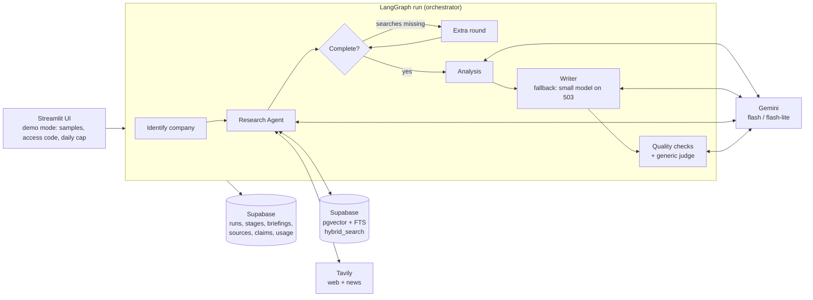

# Deal-Prep Copilot

[](https://github.com/shellybh/deal-prep-copilot/actions/workflows/ci.yml)

An AI research assistant for B2B meetings. You give it a company name and the meeting type, and about three minutes later you get a briefing in Hebrew or English. It has a one-page summary and a 12-section appendix, and every fact points to a source: either a web page or a document from the seller's own knowledge base.

**Live demo:** _link added after the deploy_. Sample briefings open without an access code. Live runs need one (ask me), because the demo runs on free-tier quotas.

> **Where it started.** This began as the capstone project of an AI developer course. The course supplied the initial idea, the initial prompt, and the demo dataset: NexaStream's internal documents, the competitor battle cards and the CRM export. I designed and wrote the architecture, the agents, the research and RAG pipelines, the evaluation, the demo mode and all the decisions in [`DECISIONS.md`](DECISIONS.md).

## What it does

1. **Identifies the company** from the web or the knowledge base. It stops and asks for the website instead of guessing, and a fictional company comes back as "not identified".
2. **Research Agent** (tool-calling, `gemini-3.5-flash-lite`):
   - hybrid search over internal documents (pgvector + Postgres full-text, combined with RRF)
   - web research in Hebrew and English through Tavily, with a credit cap
   - competitor sources

   Each source gets a credibility tier (1 official … 4 other) and a publish date. A date is never guessed.
3. **Completeness check in code.** It runs a bounded extra round only for searches that never ran.
4. **Analysis & Writing Agent** (`gemini-3.5-flash`): opportunities and risks with importance and rationale, a meeting strategy, questions and next steps. The analysis is tailored to the meeting type (sales or partnership).
5. **Quality checks**:
   - a fact without a valid source is relabeled *unverified*
   - uncited analysis is dropped
   - Hebrew words partly written in Arabic letters are fixed
   - a small-model judge removes generic statements ("the market is competitive")

The briefing labels every item: fact, internal document, user-provided, AI analysis or AI recommendation, plus low confidence and conflicting sources. Gaps go under *Missing information* instead of being filled in.

## Architecture



- **Two agents, not six.** The brief described an orchestrator plus five specialists. I merged them into two agents with Pydantic contracts at every boundary, so they can be split again later. The reasons are in D36.
- **Every run is persisted stage by stage** (7 stages × 5 statuses), with retries. A failed stage gives a partial briefing that is marked as incomplete, not a crash.
- **Usage logging:** tokens per LLM call and Tavily credits per research step.

More detail is in [`ARCHITECTURE.md`](ARCHITECTURE.md): the "as built" sections, §6.0 onwards.

## Evaluation

I ran the same 7 companies through the Phase 2B single agent (the baseline) and through the two-agent graph, with Tavily results cached so both modes saw the same sources (`evals/agent_eval.py`, logged in [`TESTING.md`](TESTING.md)).

| Company (language, meeting) | 2B: bullets / cited % | Graph: bullets / cited % (claims) | Generic statements, median of 3 judge runs (2B → graph) |
|---|---|---|---|
| Snowflake (en, sales) | 21 / 86 | 51 / 98 | 3 → 2 |
| monday.com (he, sales) | 19 / 95 | 55 / 95 | 3 → 3 |
| QuantaLake (en, sales, KB only) | 21 / 95 | 49 / 94 | 0 → 2 |
| Wix (he, partnership) | 15 / 100 | 60 / 98 | 0 → 7 |
| Siemens (en, partnership) | 14 / 86 | 62 / 98 | 2 → 2 |
| Databricks (he, sales) | 21 / 81 | 55 / 96 | 1 → 4 |
| Zorbex Dynamics (fictional) | not identified ✓ | not identified ✓ | – |

**How I read it:**
- The graph writes 2.5–4× more content with the same or a better citation rate on claims.
- It adds what the baseline lacks: an existing-relationship check from the CRM, risks, a meeting strategy and questions.
- It costs about 4× the tokens and takes 1.5–3 minutes instead of under 1 minute.
- **The generic-statement judge is noisy.** Wix scored 9 / 0 / 7 on the *same* text, so I don't rank the two modes by that column.

There is also a retrieval eval: hit@1, hit@5, MRR and answer@5 for hybrid vs semantic vs keyword search, across chunking strategies (`evals/retrieval_eval.py`).

## How it copes with free-tier limits

Everything runs on free tiers with no credit card. The tightest limit is Gemini flash at **20 requests per day**, and rejected requests count too.

- **Model per role (D41):**
  - the research tool loop runs on flash-lite (500 requests per day)
  - only analysis and writing use flash, so a run needs about 2 flash calls
  - a daily-quota 429 is not retried, and the SDK's silent retries are turned off for flash
- **Fallback writer:** if flash returns 503 "high demand" on every writing attempt, the writer tries once on flash-lite. The briefing then says it was written by the fallback model, instead of losing the research already paid for.
- **Public demo mode (D39):**
  - visitors read pre-generated sample briefings, which costs nothing
  - a live run needs an access code
  - a site-wide daily cap is counted atomically in Postgres (`claim_demo_run`) and resets with the Gemini quota
  - fail closed: no code configured, or no counter reachable, means no live runs
- **Tavily credits:** each run has a credit cap by depth (Quick 8, Standard 20, In-depth 40), and eval runs use a response cache.
- **Supabase keepalive:** free projects pause after about a week idle. A GitHub Actions workflow makes one read-only call twice a week.

## Key design decisions

The full log with context and alternatives is in [`DECISIONS.md`](DECISIONS.md).

- **D33:** a working single agent first, then the knowledge-base management API.
- **D36:** two agents instead of six, built so they can be split again later.
- **D37:** Hebrew + English search with a Tavily credit budget per depth.
- **D38:** a portfolio MVP scope. Editing, PDF export and organization management were moved to future work.
- **D40:**
  - the completeness check runs in code with no LLM call
  - meeting-type tailoring is config injected into one prompt per role
  - the generic-statement check is a small-model judge, because the prompt rule alone was ignored
- **D41:** a model per role, after measuring the free-tier quotas.

## Tech stack

| Layer | Technology |
|---|---|
| UI | Streamlit (Community Cloud) |
| Agents | LangGraph, LangChain, Pydantic contracts |
| LLM + embeddings | Google Gemini (AI Studio free tier): `gemini-3.5-flash`, `gemini-3.5-flash-lite`, `gemini-embedding-001` (1536 dims) |
| Web research | Tavily |
| Database | Supabase: Postgres + pgvector + full-text search, RLS, versioned SQL migrations |
| Backend extras | FastAPI knowledge-base API with roles and RLS, plus a DB-backed job queue for ingestion (built in the early phases, not used by the demo UI) |
| Tests / CI | pytest (277 unit tests, plus integration tests against a dev project), gitleaks, GitHub Actions |

## About the demo data

The knowledge base holds synthetic internal documents of **NexaStream**, a fictional analytics company. The course provided them:
- pricing guides
- competitor battle cards
- customer case studies
- sales playbooks
- a small CRM export of past deals ([`crm_historical_win_loss_data_2025_2026.csv`](crm_historical_win_loss_data_2025_2026.csv)), indexed as a regular searchable document

Every briefing is written from NexaStream's point of view. The external research is real, through Tavily, and the internal facts come from these synthetic documents. In a real deployment, an organization would load its own documents through the knowledge-base API or `backend/ingest_data.py`.

## Known limitations

- **Industry Overview** is often generic: the judge doesn't check that section.
- **The latest financials** are sometimes a year old.
- **Facts backed only by tier-4 sources** (for example a headquarters city) are marked low confidence.
- **News varies between runs:** live runs aren't cached.
- **Hebrew wording** has occasional typos.
- **The competitor section** sometimes lists our own competitors even when the target company has no link to them.
- **Two request fields** (`compare_with` and `focus`) are accepted but not used by the agents yet.

## Future work

- **Agents:** split the Research Agent into parallel internal / web / competitor agents (D36).
- **Briefings:** editing with an immutable original, version comparison, PDF export (a Hebrew RTL spike passed), follow-up research.
- **Product:**
  - an organization profile and personal profiles
  - templates
  - an admin settings UI with versions and rollback
  - feedback and claim reports
  - per-user quotas and cost views
- **UI:**
  - a React frontend: a skeleton was built and set aside for Streamlit (D39)
  - a knowledge-base management screen: the API exists
- **Ingestion:** OCR for scanned PDFs.

## Run it locally

Windows, Python 3.12:

```
py -3.12 -m venv .venv
.venv\Scripts\activate
python -m pip install -r requirements.txt
copy .env.example .env          # fill in Gemini, Tavily and Supabase keys
```

1. **Database:** apply `supabase/migrations/` in order (`supabase link --project-ref <ref>`, then `supabase db push`).
2. **Knowledge base:** `cd backend` and `python ingest_data.py`. It indexes `rag_knowledge_base/` and the CRM CSV, and it is safe to re-run.
3. **UI:** `streamlit run app.py` from the repo root. Set `DEMO_MODE=off` in `.env` for local development. Without it, demo mode is on and live runs need a code.
4. **CLI:**
   - from `backend/`: `python agent.py --company "monday.com" --website monday.com --country Israel --language he`
   - add `--single` for the 2B baseline
   - exit code 3 means the company wasn't identified
5. **Tests:** `cd backend`, then `python -m pytest -q` for the unit tests. Add `-m integration` to run them against a real Supabase dev project.

Deployment is described in [`deployment_guide.md`](deployment_guide.md).

---

This was developed in a private repository in November 2026 and published here with a condensed history.
